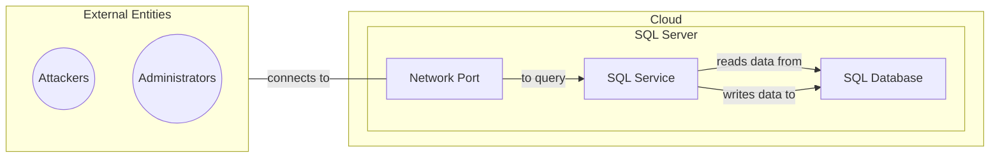

# Introduction
## Context & Prerequisites
### The Cloud Administrator's Role in Information Security
Cloud administrators provision and maintain Information Technology (IT) resources on behalf of their organization. Information security is a function of IT. Therefore, it should be important to a cloud administrator. Yet, it should not should not consume all of their time or attention. They are not responsible for researching and responding to security threats. They are also not responsible for managing priorities, time, or money. Information security is a team sport. It requires teamwork amongst between IT managers, IT administrators, IT security analysts, and business administrators. The cloud administrator should specifically focus on how the cloud resources they managed are configured and patched. The best way to go about this is using a robust framework of information security controls. 

### Information Security Control Frameworks
Most organizations are legally required to implement information security best practices. For example, the United States (US) Federal Information Security Management Act (FISMA) requires all US federal agencies to develop, document, and implement an information security program. This involves producing risk assessments, security policies, and security procedures as well as conducting security awareness training and incident response. If you work for a US federal agency, you will eventually find yourself following the advice provided in National Institute of Standards and Technology (NIST) Special Publication (SP) 800-53, "Security and Privacy Controls for Information Systems and Organizations." An alternative to NIST SP 800-53 is the Center for Internet Security (CIS) Critical Security Controls (CSCs). The difference between the two is NIST SP 800-53 focuses on complying with information security laws in the US while the CIS CSC was designed for general use. The CIS CSCs are also more specific and can have a practical impact on improving an organization's security posture. For this week's project, we will implement a few of the CIS CSCs to secure a Structured Query Language (SQL) service within an Azure-based environment. 

### Project Scenario
You are the Cloud Administrator for Pizza Planet, a family-friendly restaurant known for its Chicago-style deep dish pizza and space-themed arcade. Since 1995, Pizza Planet has used an on-site SQL server to store customer data. Yet, the security and privacy concerns were never properly addressed and the cost of maintaining the server has become unaffordable. To save Pizza Planet, you propose migrating the SQL server to the cloud and implementing a number of information security controls. 

### SQL Service vs SQL Database
What's the difference between a SQL server, SQL service, and SQL database? A SQL server is a machine, physical or virtual, with an operating system and network interface. It houses a SQL service and SQL database. A SQL service is a process in memory that listens for SQL queries and executes them against a SQL database. A SQL database is a file that stores data read and/or written by a SQL service. See below for an illustration. 

## Objectives
**After completing this project module, you will be able to:**  
* Discuss the security requirements for deploying applications in the cloud.
* Explain how a Defense-in-Depth strategy provides protection against potentially unrelated attack vectors.
* Implement network-based access controls to protect a SQL service in Azure using a Defense-in-Depth strategy.
* Implement identity-based access controls to protect a SQL service in Azure according to the Principle of Least Privilege.
* Implement detection controls to monitor a SQL service in Azure for security events in support of a Defense-in-Depth strategy. 

## Tasks
* [Task 01: Deploy a SQL Service](task-01/README.md)
* [Task 02: Add Network-Based Access Controls](task-02/README.md)
* [Task 03: Add Identity-Based Access Controls](task-03/README.md)
* [Task 04: Add Detection Controls](task-04/README.md)